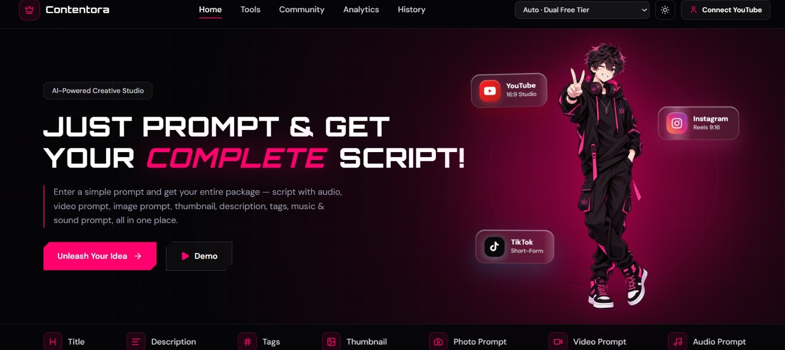

<a href="https://contentora.ai.studio">
  
</a>

<div align="center">

# Contentora

**An AI-powered creative studio that transforms a single topic into a complete, ready-to-publish content package — uniting ideation, scripting, visuals, audio, and SEO in one workspace.**

[](https://contentora.ai.studio)
[](https://github.com/anujrepox/contentora)
[](https://github.com/anujrepox/contentora)

</div>

---

## 📋 Table of Contents

| # | Section | # | Section |
|:-:|---------|:-:|---------|
| 1 | [Overview](#-overview) | 8 | [Project Workspace](#-project-workspace) |
| 2 | [Project Screenshots](#-project-screenshots) | 9 | [Storyboard & Scene Planning](#-storyboard--scene-planning) |
| 3 | [About the Project](#-about-the-project) | 10 | [Thumbnail & Packaging](#-thumbnail--packaging) |
| 4 | [Key Features](#-key-features) | 11 | [Voice & Audio Production](#-voice--audio-production) |
| 5 | [AI-Powered Content Generation](#-ai-powered-content-generation) | 12 | [YouTube SEO & Publishing](#-youtube-seo--publishing-support) |
| 6 | [Content Creation Tools](#-content-creation-tools) | 13 | [Creator Analytics](#-creator-analytics) |
| 7 | [Additional Features](#-additional-features) | 14 | [Target Audience](#-target-audience) |
| 15 | [Technology Stack](#-technology-stack) | 20 | [Future Scope](#-future-scope) |
| 16 | [Getting Started](#-getting-started) | 21 | [Security](#-security) |
| 17 | [Environment Variables](#-environment-variables) | 22 | [Team](#-team) |
| 18 | [Project Status](#-project-status) | 23 | [Our Vision](#-our-vision) |
| 19 | [Project Structure](#-project-structure) | 24 | [License & Attribution](#-license--attribution) |

---

## 🚀 Overview

> **One Idea. One Workspace. A Complete Content Creation Journey.**

Contentora is an AI-powered creative studio designed to simplify and organise the content creation process. It brings every stage of digital content production — from generating ideas and writing scripts to preparing thumbnails, audio, SEO details, and publishing materials — into **one unified workspace**.

Whether you are a YouTuber, social media creator, student, beginner, or small business owner, Contentora helps you transform a simple topic into a structured, production-ready content package.

---

## 🖥️ Project Screenshots

<table>
  <tr>
    <td width="50%" align="center">
      <strong>🏠 Homepage</strong><br><br>
      
    </td>
    <td width="50%" align="center">
      <strong>📂 Project Workspace</strong><br><br>
      
    </td>
  </tr>
  <tr>
    <td colspan="2" align="center">
      <strong>🎬 Script & Scenes</strong><br><br>
      
    </td>
  </tr>
</table>

---

## 📌 About the Project

Creating digital content involves several steps — planning, scripting, designing visuals, preparing voiceovers, writing descriptions, and optimising content for different platforms. Contentora brings these tasks together in one place.

| Step | What the User Does | What Contentora Does |
|:----:|--------------------|----------------------|
| 1 | Enters a topic or video idea | Captures the creative brief |
| 2 | Selects language, style, scene count, video format | Configures generation parameters |
| 3 | Chooses an available AI model option | Routes to the appropriate generation pipeline |
| 4 | — | Organises output into a dedicated production workspace |

Instead of switching between multiple tools for every task, creators manage their entire content workflow through a **single platform**.

---

## ✨ Key Features

<table>
  <tr>
    <th width="25%">Category</th>
    <th width="75%">Capabilities</th>
  </tr>
  <tr>
    <td>🤖 <strong>AI Content Generation</strong></td>
    <td>Structured content from topics/prompts · Multi-language (English, Hindi, Spanish, French) · Multiple content styles · Configurable scene count · Model selection</td>
  </tr>
  <tr>
    <td>📝 <strong>Creation Tools</strong></td>
    <td>Title · Description · Tags · Thumbnail · Photo Prompt · Video Prompt · Audio Prompt</td>
  </tr>
  <tr>
    <td>📂 <strong>Project Workspace</strong></td>
    <td>Overview · Packaging · Script & Scenes · Voice & Audio · YouTube SEO · Publish</td>
  </tr>
  <tr>
    <td>🎬 <strong>Storyboard & Scenes</strong></td>
    <td>Scene organisation · Narration & shot directions · Storyboard preview · Teleprompter · SRT & CSV export</td>
  </tr>
  <tr>
    <td>🎨 <strong>Thumbnail & Packaging</strong></td>
    <td>Thumbnail concepts · Upload/edit images · Image & negative prompts · PNG download · Readability checks</td>
  </tr>
  <tr>
    <td>🎙️ <strong>Voice & Audio</strong></td>
    <td>Scene-wise voiceover scripts · Voice & TTS options · Sound/music descriptions · Teleprompter · Audio integrations</td>
  </tr>
  <tr>
    <td>📈 <strong>SEO & Publishing</strong></td>
    <td>Descriptions · Chapter timestamps · Tags & hashtags · Pinned comments · Community posts · Hooks · Upload checklist</td>
  </tr>
  <tr>
    <td>📊 <strong>Creator Analytics</strong></td>
    <td>Total content · Daily streak · Projects · Scripted scenes · Status tracking · Activity history</td>
  </tr>
  <tr>
    <td>🌟 <strong>Additional</strong></td>
    <td>Community · Project history · Light/dark themes · YouTube connection · Shorts conversion · Export packages · Cross-platform support</td>
  </tr>
</table>

---

## 🤖 AI-Powered Content Generation

| Option | Available Values |
|--------|------------------|
| **Languages** | English · Hindi · Spanish · French |
| **Content Styles** | Engaging & Clear · Cinematic & Dynamic · Dramatic · Fast-Paced & Punchy · Educational & Calm |
| **Scene Count** | User-configurable per project |
| **AI Models** | Available model and generation options selectable at creation time |
| **Input** | A single topic or prompt |

---

## 📝 Content Creation Tools

| Tool | Purpose |
|------|---------|
| 🏷️ **Title** | Create engaging content titles |
| 📄 **Description** | Prepare video descriptions |
| 🔖 **Tags** | Generate relevant SEO tags |
| 🖼️ **Thumbnail** | Create and customise thumbnail concepts |
| 📸 **Photo Prompt** | Prepare prompts for image generation |
| 🎥 **Video Prompt** | Prepare video-related prompts |
| 🔊 **Audio Prompt** | Prepare audio and sound-related prompts |

---

## 📂 Project Workspace

Every generated project gets an organised workspace with six dedicated sections:

```
Project Workspace
├── 📊 Overview          → Main info, title, thumbnail, production progress
├── 📦 Packaging         → Thumbnail concepts, image prompts, editing, downloads
├── 🎬 Script & Scenes   → Individual scenes, narration, visual shot descriptions
├── 🎙️ Voice & Audio     → Voiceover text, voice options, audio settings, TTS controls
├── 📈 YouTube SEO       → Descriptions, chapters, pinned comments, community posts
└── 🚀 Publish           → Publishing requirements and distribution preparation
```

---

## 🎬 Storyboard & Scene Planning

| Feature | Description |
|---------|-------------|
| 🎞️ Scene Organisation | Break videos into individual scenes |
| 📖 Scene Details | View scene titles, narration, and visual shot directions |
| 👁️ Storyboard Preview | Preview the full storyboard |
| 📜 Teleprompter | Support for narration delivery |
| 💾 Subtitle Export | Export subtitles in **SRT** format |
| 📋 Shot List Export | Export shot lists in **CSV** format |

---

## 🎨 Thumbnail & Packaging

- 🖼️ View thumbnail concepts
- ✏️ Upload or edit thumbnail images
- 🧠 Access image prompts and negative prompts
- ⬇️ Download thumbnails in **PNG** format
- 👁️ Check thumbnail readability and title presentation

---

## 🎙️ Voice & Audio Production

- 🎬 Scene-wise voiceover scripts
- 🗣️ Available voice and text-to-speech options
- 🎵 Sound and music descriptions
- 📜 Teleprompter support for narration
- 🔌 Audio generation through available integrations

---

## 📈 YouTube SEO & Publishing Support

| Asset | Included |
|-------|:--------:|
| Video descriptions | ✅ |
| Chapter timestamps | ✅ |
| SEO tags & hashtags | ✅ |
| Pinned comments | ✅ |
| Community posts | ✅ |
| Opening hooks & engagement assets | ✅ |
| Upload-readiness checklist | ✅ |
| Production package download | ✅ |
| YouTube upload sheet | ✅ |

---

## 📊 Creator Analytics

The Analytics dashboard provides an overview of content production activity:

| Metric | Description |
|--------|-------------|
| 📦 Total Generated Content | All content produced across projects |
| 🔥 Daily Activity Streak | Consecutive days of creation activity |
| 📁 Total Projects | Number of projects created |
| 🎬 Scripted Scenes | Total scenes scripted |
| 📌 Project Status Tracking | Progress state of each project |
| 📅 Daily Activity History | Day-by-day production log |

---

## 🌟 Additional Features

- 👥 Community section
- 🕘 Project history
- 🌗 Light and dark themes
- 🔗 YouTube connection option
- ✂️ Convert content into Shorts
- 📦 Export and production package options
- 🌐 Cross-platform promotional content support

---

## 🎯 Target Audience

| Audience | Use Case |
|----------|----------|
| 🎥 YouTubers & Video Creators | End-to-end video production planning |
| 📱 Instagram & Social Media Creators | Multi-platform content packaging |
| 🌱 Beginner Content Creators | Guided, structured creation workflow |
| 🎓 Students & Aspiring Creators | Learning content production step by step |
| 💼 Small Businesses & Digital Marketers | Efficient promotional content at scale |

---

## 🛠️ Technology Stack

| Area | Technologies |
|------|--------------|
| **Frontend** | HTML · CSS · JavaScript |
| **Backend** | Node.js · Express.js |
| **AI Integrations** | External AI models and APIs |
| **Content Support** | Image generation and text-to-speech integrations |

---

## ⚙️ Getting Started

### Prerequisites

| Requirement | Notes |
|-------------|-------|
| Node.js | Required runtime |
| npm | Package manager |
| Code Editor | e.g., Visual Studio Code |

### Installation

```bash
# 1. Clone the repository
git clone https://github.com/anujrepox/contentora.git

# 2. Navigate to the project directory
cd contentora

# 3. Navigate to the Frontend folder
cd Frontend

# 4. Install dependencies
npm install

# 5. Configure environment variables (see below)
#    Create a .env file inside the Frontend folder

# 6. Start the server
node server.js
```

### Open the Application

```
http://localhost:5000/idea.html
```

---

## 🔑 Environment Variables

Create a `.env` file inside the `Frontend` folder and add the required API credentials using the variable names expected by the application.

| Variable | Purpose |
|----------|---------|
| `AI_API_KEY` | API key for the AI content generation provider |
| `IMAGE_API_KEY` | API key for image generation services |
| `TTS_API_KEY` | API key for text-to-speech services |

> ⚠️ **Note:** Variable names shown are illustrative. Use the exact variable names expected by the application.

---

## 📌 Project Status

> **Contentora is currently under development as a working prototype for a college hackathon.**

| Component | Status |
|-----------|:------:|
| Main interface | ✅ Complete |
| Content creation workflow | ✅ Complete |
| Project workspace | ✅ Complete |
| Scene planning | ✅ Complete |
| Thumbnail & packaging tools | ✅ Complete |
| Analytics dashboard | ✅ Complete |
| Publishing support | ✅ Complete |
| AI content generation | 🧪 Testing & improving |
| Scene-specific image generation | 🧪 Testing & improving |
| Text-to-speech | 🧪 Testing & improving |

Our goal is to make the platform more reliable and enhance the overall content creation experience.

---

## 📁 Project Structure

```
contentora/
├── Frontend/
│   ├── public/                  # Static assets & pages
│   │   └── idea.html            # Entry point (http://localhost:5000/idea.html)
│   ├── server.js                # Express server entry
│   ├── package.json             # Dependencies & scripts
│   └── .env                     # API credentials (never commit)
└── README.md
```

---

## 🔮 Future Scope

| Priority | Improvement |
|:--------:|-------------|
| 🔴 High | More reliable AI-powered content generation |
| 🔴 High | Improved scene-specific image generation |
| 🟠 Medium | More stable voiceover and audio generation |
| 🟠 Medium | Enhanced YouTube integration |
| 🟡 Low | Advanced analytics and publishing support |
| 🟡 Low | Improved export and cross-platform content workflows |

---

## 🔐 Security

> **⚠️ Important:** API credentials and private configuration files should always be stored securely using environment variables.

| Rule | Description |
|------|-------------|
| ✅ Do | Store keys in `.env` files |
| ✅ Do | Add `.env` to `.gitignore` |
| ❌ Don't | Upload API keys, passwords, or `.env` files to a public GitHub repository |
| ❌ Don't | Hardcode credentials in source files |

---

## 👥 Team

| Attribute | Detail |
|-----------|--------|
| **Project Name** | Contentora |
| **Project Type** | AI-Powered Content Production Platform |
| **Developed As** | College Hackathon Project |
| **Repository** | [github.com/anujrepox/contentora](https://github.com/anujrepox/contentora) |

---

## 💡 Our Vision

<div align="center">

> ### One Idea. One Workspace. A Complete Content Creation Journey.

*Contentora aims to make digital content creation more organised, accessible, and efficient.*

</div>

---

## 📄 License & Attribution

This project is developed as a college hackathon prototype. All external AI models, APIs, and third-party services remain subject to their respective licenses and terms of service.

---

<div align="center">

**[⬆ Back to Top](#contentora)**

Made with ❤️ by the Contentora Team

</div>
